# Card Spend Intelligence

I had a year of credit card statements from three different cards sitting in a folder, all of them password protected PDFs, and no easy way to see where the money was actually going. Bank apps show one card at a time and mostly just list transactions. So I built this.

It's a small dashboard that runs on your own computer. You point it at the folder where you keep your statements, type each card's PDF password once, and it pulls every transaction into one place: monthly spend, categories, merchants, fees you didn't need to pay, subscriptions you forgot about, and how much you could save.

Nothing leaves your machine. The PDFs are unlocked inside your browser tab, passwords are never saved, and the data is kept in a SQLite file next to the app.

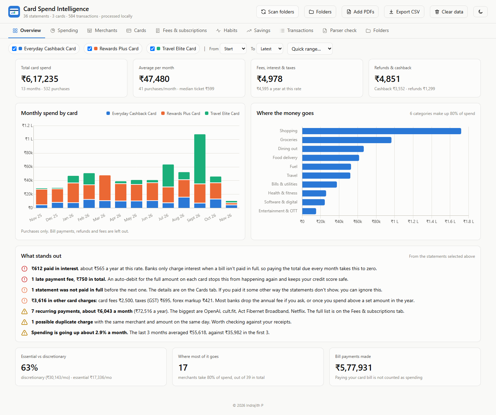

All screenshots use made up demo data.

## What it shows

**Overview.** Total and monthly spend split by card, the categories that eat most of your money, and a short list of findings like late fees, interest, duplicate charges or spending that keeps creeping up.

**Spending.** A calendar of daily spending for the last year, then every category with its share, average ticket size and how it changed over the period. You can mark any category as essential or discretionary and the rest of the dashboard follows. Also spend by weekday, by day of the month (useful for spotting the post-salary splurge) and by hour, if your bank prints transaction times.

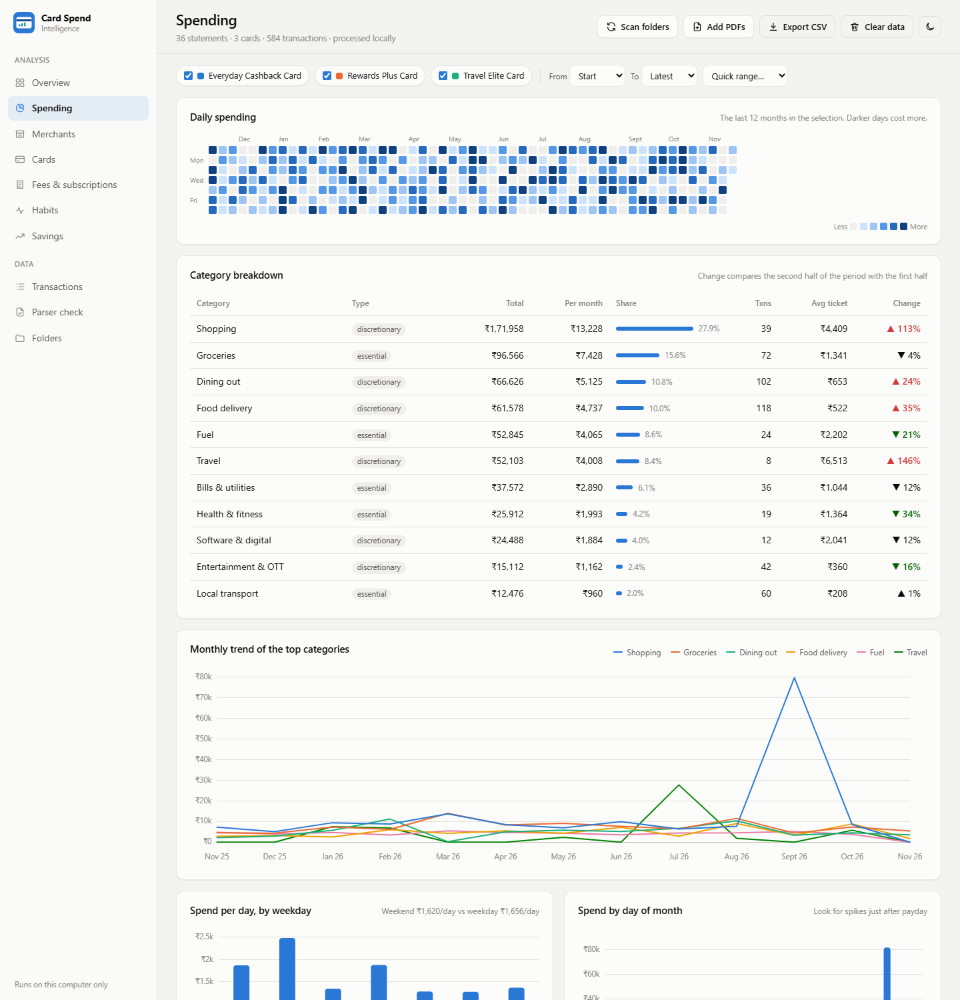

**Merchants.** Merchant names get cleaned up, so `SWIGGY BANGALORE`, `SWIGGY LIMITED` and friends all count as Swiggy. The list is ranked with ABC classes, so you can see the handful of places that take 80% of your money. If a merchant lands in the wrong category, click the category and pick another. Every transaction from that merchant follows, including future statements.

**Cards.** A side by side comparison of your cards: spend, cashback, reward points, fees, interest and the net benefit of each card. It also tracks credit utilization per statement and checks whether every bill was paid in full.

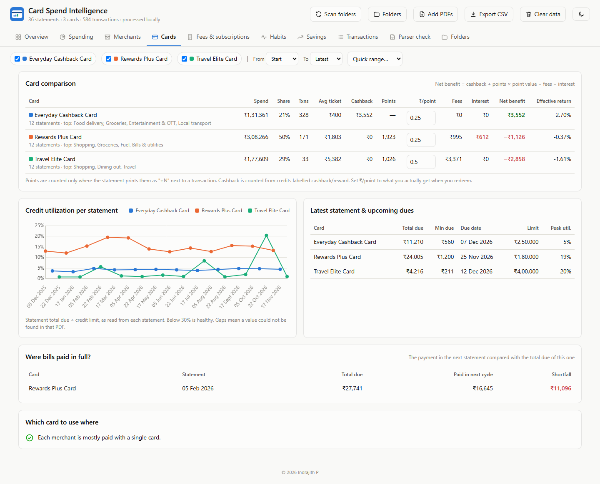

**Fees and subscriptions.** Interest, late fees, annual fees, GST on those fees, forex markup and fuel surcharge, each shown as what you paid and what it costs you per year. Below that, recurring payments and subscriptions, possible duplicate charges and transactions that look unusual for their category.

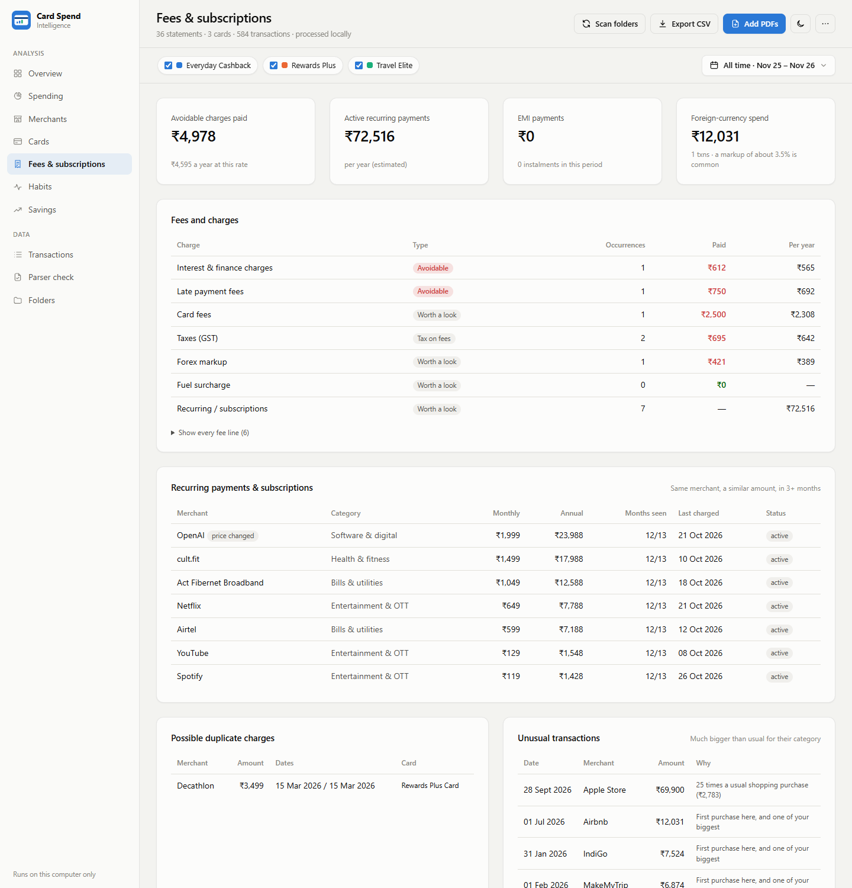

**Habits.** A few simple signals: how much goes to food delivery, how often you make small purchases, weekend and late night spending, whether spending is rising, and which categories grew the most.

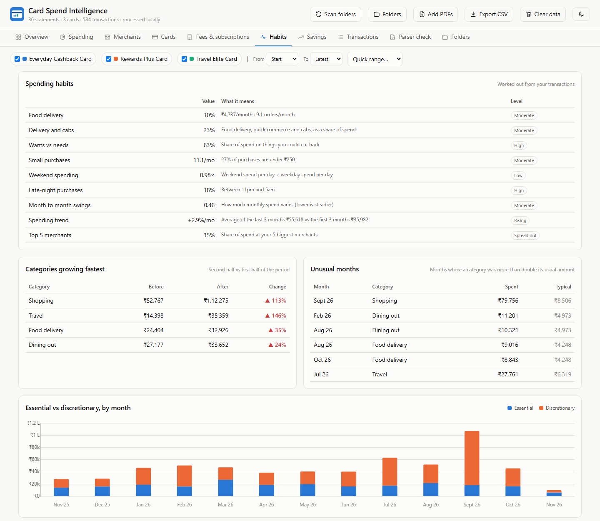

**Savings.** Pick how much you'd cut from each discretionary category and it shows the monthly saving and what that would grow to if invested. Add your income to see what share of it goes on cards. There's also a 12 month plan based on what it found.

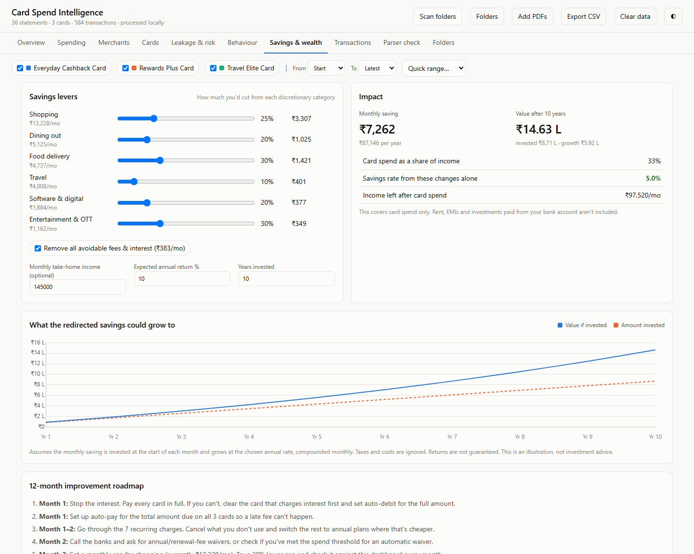

**Transactions.** Every transaction, searchable and sortable. Click a merchant to rename it, or to move a payment to another merchant or a new one, for that one transaction or for all of them. You can export to CSV.

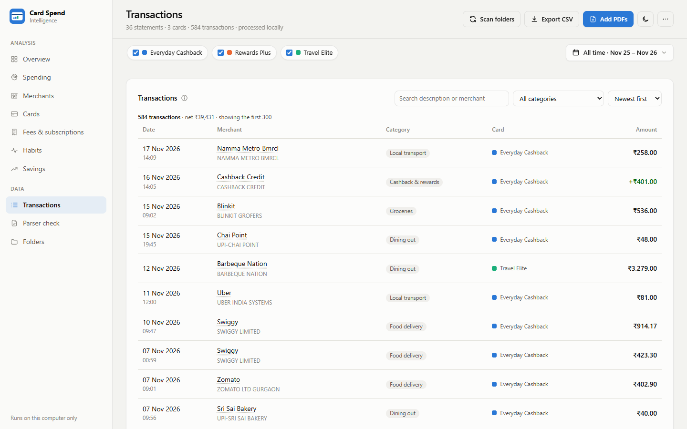

There's a dark mode too.

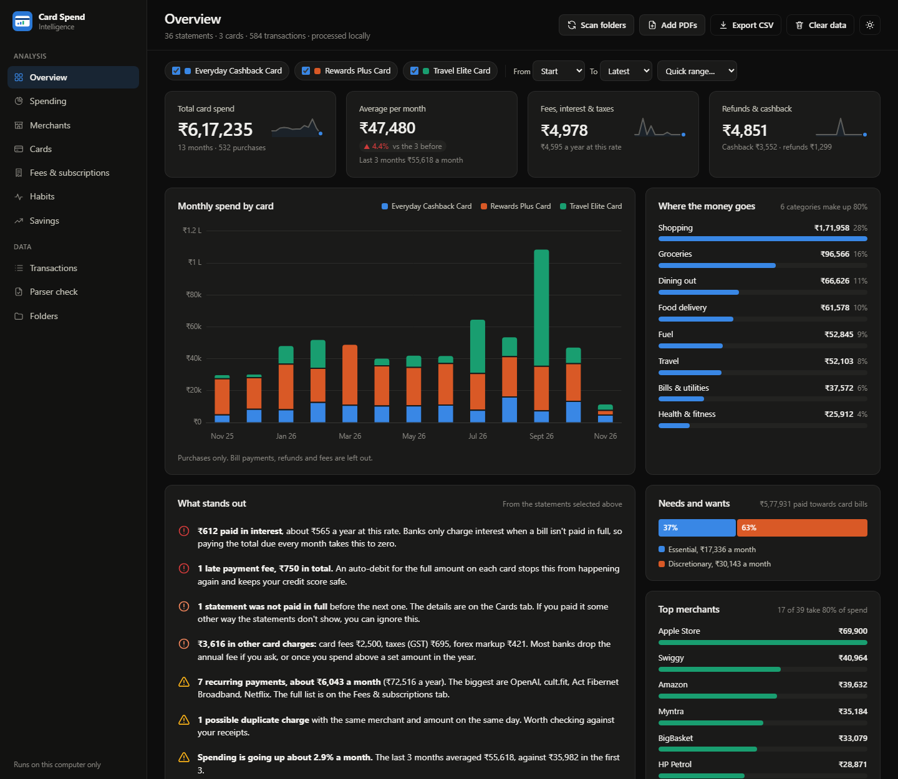

## Getting started

You need Python 3.8 or newer. There is nothing to install with pip and no build step.

1. Download or clone this repo.
2. On Windows, double click `Start Dashboard.bat`. On Linux or macOS, open a terminal in the project folder and run:

   ```
   ./start-dashboard.sh
   ```

   If it says permission denied, run `chmod +x start-dashboard.sh` once, or start it with `sh start-dashboard.sh`. You can also skip the script and run `python3 app/serve.py`.

   Your browser opens at `http://127.0.0.1:8765`.
3. Keep your statements in one folder, with one sub-folder per card. The sub-folder name becomes the card name.

   ```
   Statements/
     HDFC Millennia/
     Axis Ace/
     SBI SimplyClick/
   ```

4. Open **Folders** in the sidebar, paste the path to `Statements` and click **Add folder**. On Windows you can right click the folder in File Explorer and choose *Copy as path*. On Linux and macOS a path like `~/Statements` works.
5. Click **Import new statements**. You'll be asked for each card's PDF password once. Other files from the same card reuse it for the rest of the session.

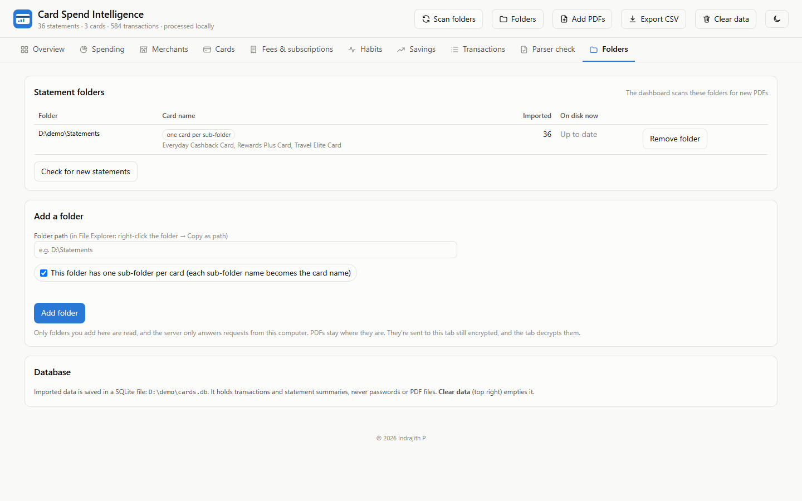

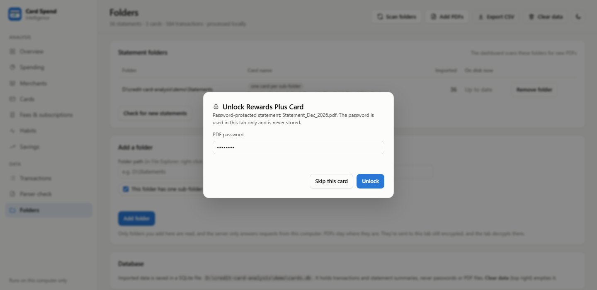

Next month, save the new PDF into the same folder and click **Scan folders**. Only new or changed files get imported, and a new card folder is picked up on its own. If you delete a PDF, the Folders tab marks it as missing and you can remove it from the database.

## Checking that a statement was read correctly

Every bank lays out its statements a little differently, so the **Parser check** tab exists to keep things honest. For each statement it takes the opening balance, adds the debits it found, subtracts the credits and compares the result with the total due printed on the statement. A tick means every transaction was picked up.

If you see a warning, click **Raw text** to see exactly which lines were read as transactions. **Copy anonymised layout** copies the statement's structure with every letter replaced by `x` and every digit by `9`. That's enough to fix the parser for a new bank layout without sharing any real data, so feel free to attach it to an issue.

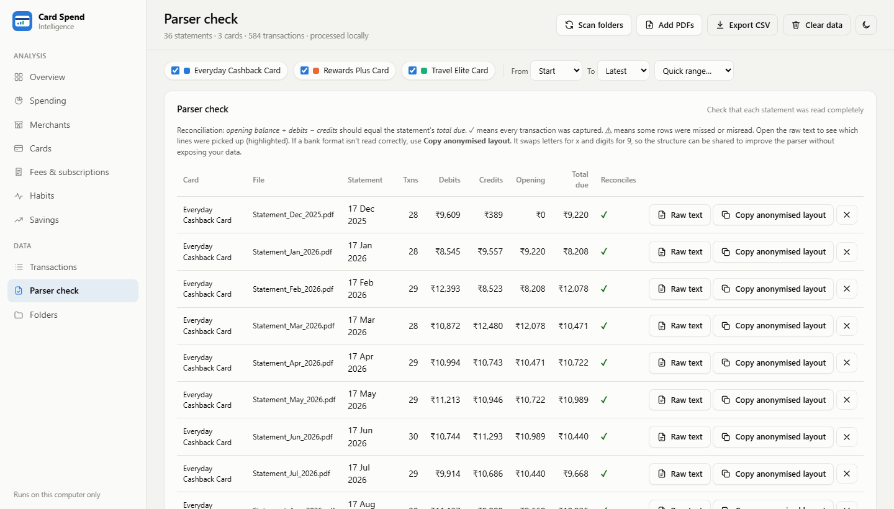

The parser expects text based PDFs, which is what banks send by email or offer for download. Scanned statements won't work because there's no OCR.

## Privacy

This was the main reason to build it instead of uploading statements to some website.

* PDFs are decrypted with pdf.js inside your browser tab. The password goes from the dialog straight to pdf.js and is dropped once the file is read.
* The local server only listens on `127.0.0.1`, so other devices on your network can't reach it. It rejects requests coming from other websites and will only read PDFs inside folders you added.
* The page has a Content Security Policy that blocks it from talking to anything except the local server. pdf.js and Chart.js are bundled in `app/vendor`, so no CDN is involved either.
* Transactions are stored in `data/cards.db`. That file is not encrypted, so it's as safe as your user account and disk. **Clear data** then **Delete everything** wipes it in one go, including the list of folders, and rewrites the file so the deleted data can't be read back from it.
* `.gitignore` keeps PDFs, CSV exports, the database and your statement folders out of git, in case you fork this and keep your statements next to it.

## Options

```
python app/serve.py 9000
python app/serve.py --db D:\Finance\cards.db
python app/serve.py --no-browser
```

The Linux launcher passes these through, so `./start-dashboard.sh --db ~/finance/cards.db` works too.

The first runs on a different port, the second keeps the database somewhere else and the third starts the server without opening a browser.

Categories are plain regex rules in `app/js/categorize.js`, tuned for Indian merchants. Adding your own is usually one line.

## Project layout

```
app/
  index.html          the page
  favicon.svg         app icon
  serve.py            local server, SQLite storage and folder scanning
  js/parser.js        PDF unlocking and transaction extraction
  js/categorize.js    merchant clean up and category rules
  js/analysis.js      all the numbers
  js/app.js           dashboard UI
  js/icons.js         the icon set
  css/styles.css      styles, light and dark
  vendor/             pdf.js 3.11.174 and Chart.js 4.4.1
docs/screenshots/     images used in this README
Start Dashboard.bat   Windows launcher
start-dashboard.sh    Linux and macOS launcher
```

## Known limitations

* Built around the statement layouts of a few Indian banks. Others will probably work since most follow the same date, description, amount pattern, but look at the Parser check tab the first time.
* Reward points are only counted when the statement prints them next to each transaction.
* Insights are based on card spend only. Rent, EMIs and anything paid from your bank account aren't included.
* The savings projection is a simple compound interest illustration, not financial advice.

## Contributing

Issues and pull requests are welcome. If a bank's statement isn't read properly, open an issue with the anonymised layout from the Parser check tab.

## License

MIT. See [LICENSE](LICENSE).
